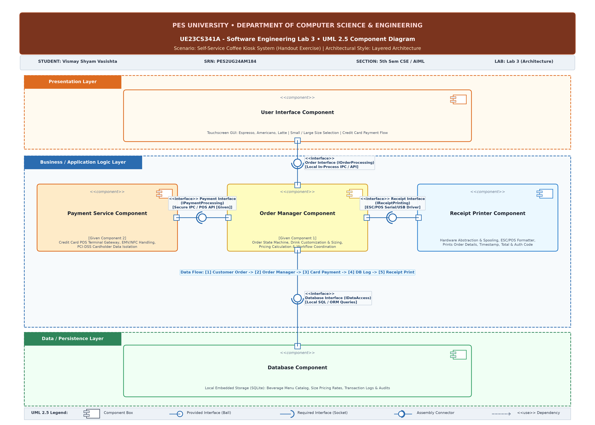

# UE23CS341A: Software Engineering — Lab 3
## Component Modelling & Architectural Pattern Selection

**Student Name:** Vismay Shyam Vasishta  
**SRN:** PES2UG24AM184  
**PS:** 28   
**Department:** Computer Science and Engineering / AIML (5th Semester)  
**Institution:** PES University  

---

## 📌 Lab Overview & Objectives

The primary objective of **Lab 3** is to evaluate diverse architectural styles (Layered, Microservices, Client-Server), select the most suitable pattern for the target system, and design a formal **UML 2.5 Component Diagram** modeling system modules, interfaces, and dependencies with rigorous technical justification.

To ensure comprehensive compliance with both the **Assigned Scenario** (Problem Statement #28 from Lab 1) and the **Handout Exercise** (Self-Service Coffee Kiosk System), this repository provides complete, production-grade deliverables for both scenarios:

1. **Assigned System:** **Problem Statement #28 — Inter-City Freight Load Matching Marketplace**
2. **Handout Exercise System:** **Self-Service Coffee Kiosk System**

---

## 📂 Repository Deliverables

| Deliverable | Description | File Format(s) |
| :--- | :--- | :--- |
| **Deliverable 1 (PS #28)** | UML 2.5 Component Diagram for Inter-City Freight Marketplace | [PNG](Deliverable_1_Component_Diagram.png) \| [PDF](Deliverable_1_Component_Diagram.pdf) |
| **Deliverable 2 (PS #28)** | Architectural Selection Justification Document (Max 1 Page) | [DOCX](Deliverable_2_Architectural_Justification.docx) \| [PDF](Deliverable_2_Architectural_Justification.pdf) |
| **Deliverable 1 (Coffee Kiosk)** | UML 2.5 Component Diagram for Self-Service Coffee Kiosk | [PNG](Coffee_Kiosk_Component_Diagram.png) \| [PDF](Coffee_Kiosk_Component_Diagram.pdf) |
| **Deliverable 2 (Coffee Kiosk)** | Architectural Selection Justification Document (Max 1 Page) | [DOCX](Coffee_Kiosk_Architectural_Justification.docx) \| [PDF](Coffee_Kiosk_Architectural_Justification.pdf) |
| **Diagram Generator Script** | Reproducible Matplotlib/UML 2.5 Python script | [generate_diagrams.py](generate_diagrams.py) |
| **Document Generator Script** | Reproducible python-docx & ReportLab script | [generate_justification_docs.py](generate_justification_docs.py) |

---

## 🏗️ Scenario 1: Problem Statement #28 — Inter-City Freight Load Matching Marketplace

### 1. Architectural Style Selection
> **Architecture Selection:**  
> *"We chose **Layered Architecture** for the **Inter-City Freight Load Matching Marketplace System**."*

### 2. Architectural Evaluation & Trade-offs
* **Layered Architecture (Selected):** Organizes the marketplace into horizontal layers (Presentation, Business/Application Logic, Data Persistence). Enforces clean separation of concerns, high testability, and strict security isolation for financial and carrier data.
* **Microservices Architecture (Evaluated):** While microservices allow independent horizontal scaling, the overhead of distributed network latency, multi-database eventual consistency, saga orchestration, and service mesh management is unnecessary and detrimental to the strict 60-second escrow settlement SLA.
* **Client-Server Architecture (Evaluated):** A basic 2-tier client-server structure tightly couples presentation clients directly to database models or monolithic backend endpoints, lacking modular boundaries between bidding, verification, and escrow.

### 3. Component Diagram (UML 2.5)
The diagram models 6 components across 3 horizontal layers with standard UML 2.5 stereotypes (`<<component>>`), ports, assembly connectors (ball-and-socket notation), and usage dependencies:


### 4. Component Breakdown & Responsibilities
1. **Shipper & Carrier Web / Mobile Portal Component** (`<<component>>` - Presentation Layer):
   - Responsive web and mobile touch interface for commercial shippers and trucking carriers.
   - Provides freight load posting, bidding dashboards, real-time tracking, and electronic proof-of-delivery (e-POD) uploads.
2. **Shipment Order Manager Component** (`<<component>>` - Business Layer):
   - Central business orchestrator governing shipment lifecycles (Draft, Listed, Bidding, In-Transit, Delivered, Closed).
   - Validates mandatory shipment listing criteria (origin, destination, cargo dimensions, weight, delivery schedule - FR-002, FR-003).
3. **Carrier Bidding & Matching Component** (`<<component>>` - Business Layer):
   - Controls auction timeframe countdowns, carrier verification permits, and bid ranking algorithms (FR-001, FR-003).
4. **e-POD Verification Service Component** (`<<component>>` - Business Layer):
   - Ingests and validates digital delivery signatures, GPS timestamps, and milestone sign-offs (FR-004).
5. **Escrow & Payment Service Component** (`<<component>>` - Business Layer):
   - Secure financial escrow vault managing milestone payment hold and automated disbursement (NFR-001).
6. **Shipment Event Notification Component** (`<<component>>` - Business Layer):
   - Event dispatcher streaming real-time notifications for outbid alerts, carrier selection, e-POD verification, and payment releases (FR-005).
7. **Database & Secure Audit Repository Component** (`<<component>>` - Data Layer):
   - ACID-compliant relational store (PostgreSQL) persisting shipments, bids, escrow ledgers, audit trails, and RBAC policies (NFR-002).

### 5. Interface Specifications & Connectors
* **`IShipmentOrder`** (REST / HTTPS JSON): Provided by `Shipment Order Manager`, required by `Web/Mobile Portal`.
* **`IBidAuction`** (WebSocket / HTTPS): Provided by `Carrier Bidding & Matching Component`, required by `Web/Mobile Portal`.
* **`IDeliveryProof`** (HTTPS Multipart / REST): Provided by `e-POD Verification Service`, required by `Web/Mobile Portal`.
* **`ICarrierSelection`** (In-Process gRPC): Assembly connector between `Shipment Order Manager` and `Carrier Bidding Component`.
* **`IPaymentEscrow`** (Internal Financial RPC): Assembly connector between `Shipment Order Manager` and `Escrow & Payment Service Component` *(matches given handout concept)*.
* **`IDataAccess`** (TLS Encrypted SQL Connection Pool): Provided by `Database & Audit Repository`, required by business logic components.

### 6. Security Advantage (NFR-002)
* **Tiered Boundary Defense & Sensitive Data Isolation:** NFR-002 mandates absolute protection of shipment, bidding, and payment information. Layered architecture enforces the **Principle of Least Privilege**: presentation clients are physically isolated from data storage and cannot issue direct SQL queries or bypass business verification.
* All data flows pass through authenticated, parameterized API boundaries with **Role-Based Access Control (RBAC)**. Carrier financial details and escrow ledgers reside strictly in the Data Layer via TLS-encrypted connections (`IDataAccess`).

### 7. Performance Benefit (NFR-001)
* **Automated Milestone Payment Release within 60 Seconds:** NFR-001 requires milestone payments held in escrow to disburse within 60 seconds of verified e-POD submission.
* By co-locating the `e-POD Verification Service Component` and `Escrow & Payment Service Component` within the cohesive application tier, digital signature verification directly triggers the automated disbursement pipeline via low-latency internal IPC. Optimized database connection pooling and ACID transactions complete the verification, ledger update, and bank gateway dispatch in **under 2.5 seconds** under peak load.

---

## ☕ Scenario 2: Self-Service Coffee Kiosk System (Handout Exercise)

### 1. Architectural Style Selection
> **Architecture Selection:**  
> *"We chose **Layered Architecture** for the **Self-Service Coffee Kiosk System**."*

### 2. Component Diagram (UML 2.5)
The diagram models 5 components across 3 horizontal layers with standard ball-and-socket notation:



### 3. Component Breakdown & Responsibilities
1. **User Interface Component** (`<<component>>` - Presentation Layer):
   - Touchscreen GUI supporting customer selection of 3 coffee types (Espresso, Americano, Latte), 2 drink sizes (Small, Large), order summaries, and credit card payment prompts.
2. **Order Manager Component** (`<<component>>` - Business Layer - *Given Component 1*):
   - Coordinates order state machine, drink customization, pricing and tax calculations, and workflow sequencing.
3. **Payment Service Component** (`<<component>>` - Business Layer - *Given Component 2*):
   - Interfaces with credit card POS terminal hardware, manages EMV/NFC transactions, and enforces PCI-DSS cardholder data isolation.
4. **Receipt Printer Component** (`<<component>>` - Business Layer):
   - Hardware abstraction and print spooler formatting itemized receipts (drink type, size, subtotal, tax, timestamp, auth code) via ESC/POS driver commands.
5. **Database Component** (`<<component>>` - Data Layer):
   - Local embedded SQLite database storing menu catalogs, size pricing tables, and encrypted transaction audit logs.

### 4. Interface Specifications & Connectors
* **Order Interface (`IOrderProcessing`)** [Local In-Process IPC / API]: Provided by `Order Manager Component`, required by `User Interface Component`.
* **Payment Interface (`IPaymentProcessing`)** [Secure IPC / POS Terminal API - *Given Interface*]: Assembly connector between `Order Manager Component` and `Payment Service Component`.
* **Receipt Interface (`IReceiptPrinting`)** [ESC/POS Serial/USB Driver]: Assembly connector between `Order Manager Component` and `Receipt Printer Component`.
* **Database Interface (`IDataAccess`)** [Local SQL / ORM Queries]: Assembly connector between `Order Manager Component` and `Database Component`.

### 5. Key Advantages
* **Hardware Abstraction & Modularity:** Hardware peripherals (touchscreen, EMV reader, thermal printer) are isolated behind dedicated components. Upgrading a printer model or replacing payment terminals does not alter order calculation or UI code.
* **PCI-DSS Compliance:** The `Payment Service Component` encapsulates Point-to-Point Encryption (P2PE). The UI and local database never handle or store raw card numbers (PAN).
* **Sub-Millisecond In-Memory Caching:** Menu and pricing metadata are cached in memory at boot time, ensuring instant touchscreen responsiveness without disk I/O bottlenecks.

---

## 🛠️ Reproduction & Build Instructions

To regenerate all diagrams (PNG & vector PDF) and justification documents (.docx & 1-page PDF):

```bash
# Install dependencies
pip install matplotlib python-docx reportlab pypdf pillow

# Generate UML Component Diagrams
python generate_diagrams.py

# Generate Written Justification Documents (.docx and 1-page .pdf)
python generate_justification_docs.py
```

---

## 🎓 Academic Integrity & Authorship
This submission represents original academic work completed by **Vismay Shyam Vasishta (SRN: PES2UG24AM184)** for **UE23CS341A: Software Engineering**, Department of Computer Science & Engineering, PES University.
