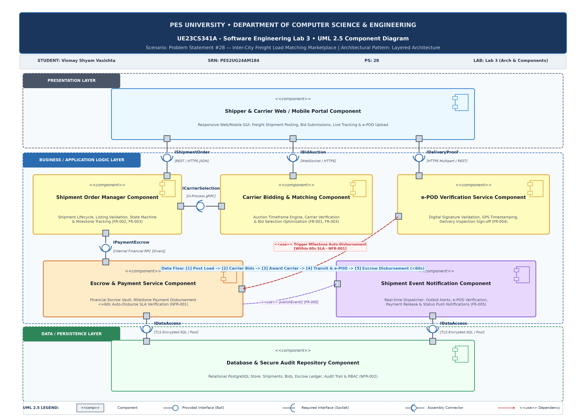

# UE23CS341A: Software Engineering — Lab 3
## Component Modelling & Architectural Pattern Selection

**Student Name:** Vismay Shyam Vasishta  
**SRN:** PES2UG24AM184  
**PS:** 28  
**Department:** Computer Science and Engineering / AIML (5th Semester)  
**Institution:** PES University  

---

## 📌 Lab Overview & Objectives

The primary objective of **Lab 3** is to evaluate architectural styles (Layered, Microservices, Client-Server), select the most suitable architectural pattern for the assigned scenario, and design a formal **UML 2.5 Component Diagram** modeling modules, interfaces, and dependencies with rigorous technical justification.

* **Assigned System:** **Problem Statement #28 — Inter-City Freight Load Matching Marketplace**
* **Domain:** Smart Cities, Transport & Logistics
* **Core Context:** A B2B freight brokerage exchange where commercial shippers post cargo loads and verified trucking carriers submit competitive bids, with automated milestone payment release upon proof-of-delivery (e-POD) sign-off.

---

## 🔗 Traceability & Parent Dependency (Lab 1)

> **Upstream Dependency:** This lab directly derives from and realizes the system requirements established in **[Lab 1: Requirements Engineering & UML Use-Case Modelling](../README.md)** (Problem Statement #28).

```
┌────────────────────────────────────────────────────────┐
│                        LAB 1                           │
│  Requirements Engineering & Use-Case Behavioral Model  │
│  • Problem Statement #28 (Freight Load Marketplace)    │
│  • Requirements: FR-001 to FR-005, NFR-001, NFR-002    │
│  • Actors: Shipper, Freight Carrier, Escrow Service    │
│  • Use Cases: Bidding, e-POD, Escrow Milestone Release │
└───────────────────────────┬────────────────────────────┘
                            │
              Direct Structural Realization
             (Requirements → Architecture)
                            ▼
┌────────────────────────────────────────────────────────┐
│                        LAB 3                           │
│   Component Modelling & Architectural Pattern Choice   │
│  • Selected Pattern: 3-Tier Layered Architecture       │
│  • UML 2.5 Component Diagram (6 components, 3 layers)  │
│  • Components directly realizing Lab 1 Use Cases:      │
│    - Shipment Order Manager Component (FR-002, FR-003) │
│    - Carrier Bidding & Matching Component (FR-001)     │
│    - e-POD Verification Service Component (FR-004)     │
│    - Escrow & Payment Service Component (NFR-001)      │
│    - Secure Database & Audit Repository (NFR-002)      │
└────────────────────────────────────────────────────────┘
```

---

## 📂 Lab 3 Deliverables

| Deliverable | Description | File Format |
| :--- | :--- | :---: |
| **Deliverable 1** | UML 2.5 Component Diagram for Inter-City Freight Marketplace | [PNG](Deliverable_1_Component_Diagram.png) |
| **Deliverable 2** | Architectural Selection Justification Document (Max 1 Page) | [PDF](Deliverable_2_Architectural_Justification.pdf) |
| **Faculty Problem Statement** | Official Lab 1 & 3 Problem Statement Sheet (PS #28) | [PDF](28_SE_Lab1_SE_Problem_Statements.pdf) |
| **Faculty Student Handout** | Official Faculty Lab 3 Guidelines & Component Modeling Criteria | [PDF](Lab_3_Architecture_Student_handout.pdf) |

---

## 🏗️ Architectural Selection & Evaluation

### 1. Architectural Style Selection
> **Architecture Selection:**  
> *"We chose **Layered Architecture** for the **Inter-City Freight Load Matching Marketplace System**."*

### 2. Comparative Evaluation & Trade-offs

| Architectural Style | Evaluation for PS #28 | Pros | Cons / Reason for Rejection |
| :--- | :--- | :--- | :--- |
| **Layered Architecture** *(Selected)* | **Optimal Choice:** Separates presentation clients from business logic and sensitive financial ledgers into distinct horizontal tiers. | • High modularity & separation of concerns<br>• Physical isolation of payment escrow vault<br>• In-process low-latency IPC satisfying 60s SLA | • Component changes across layers require interface contracts |
| **Microservices Architecture** *(Evaluated)* | **Rejected:** Decomposing into independent network microservices introduces unwarranted distributed latency and saga orchestration. | • Independent scaling of bidding vs order management | • Distributed 2-phase commits/sagas endanger the strict 60s milestone payment SLA<br>• High DevOps & network partition complexity |
| **Client-Server Architecture** *(Evaluated)* | **Rejected:** 2-tier client-server tightly couples client apps with monolithic backend endpoints or databases. | • Simple initial deployment | • Poor separation between auction rules and financial escrow<br>• Scalability bottleneck & lack of security isolation |

---

## 🧩 Deliverable 1: UML 2.5 Component Diagram

The UML 2.5 Component Diagram models 6 modular components organized across 3 horizontal layers with standard stereotypes (`<<component>>`), ports, assembly connectors (ball-and-socket notation), and usage dependencies:



### Component Breakdown & Responsibilities
1. **Shipper & Carrier Web / Mobile Portal Component** (`<<component>>` - *Presentation Layer*):
   - Touch/web interface for commercial shippers and trucking carriers.
   - Provides freight load posting, bidding dashboards, real-time tracking, and electronic proof-of-delivery (e-POD) uploads.
2. **Shipment Order Manager Component** (`<<component>>` - *Business Layer*):
   - Central business orchestrator governing shipment lifecycles (Draft, Listed, Bidding, In-Transit, Delivered, Closed).
   - Validates mandatory shipment listing criteria (origin, destination, cargo dimensions, weight, delivery schedule - **FR-002**, **FR-003**).
3. **Carrier Bidding & Matching Component** (`<<component>>` - *Business Layer*):
   - Controls auction timeframe countdowns, carrier verification permits, and bid ranking algorithms (**FR-001**, **FR-003**).
4. **e-POD Verification Service Component** (`<<component>>` - *Business Layer*):
   - Ingests and validates digital delivery signatures, GPS timestamps, and milestone sign-offs (**FR-004**).
5. **Escrow & Payment Service Component** (`<<component>>` - *Business Layer*):
   - Secure financial escrow vault managing milestone payment hold and automated disbursement (**NFR-001**).
6. **Shipment Event Notification Component** (`<<component>>` - *Business Layer*):
   - Event dispatcher streaming real-time notifications for outbid alerts, carrier selection, e-POD verification, and payment releases (**FR-005**).
7. **Database & Secure Audit Repository Component** (`<<component>>` - *Data Persistence Layer*):
   - ACID-compliant relational store (PostgreSQL) persisting shipments, bids, escrow ledgers, audit trails, and RBAC policies (**NFR-002**).

### Interface Specifications & Connectors
* **`IShipmentOrder`** `[REST / HTTPS JSON]`: Provided by `Shipment Order Manager`, required by `Web/Mobile Portal`.
* **`IBidAuction`** `[WebSocket / HTTPS]`: Provided by `Carrier Bidding & Matching Component`, required by `Web/Mobile Portal`.
* **`IDeliveryProof`** `[HTTPS Multipart / REST]`: Provided by `e-POD Verification Service`, required by `Web/Mobile Portal`.
* **`ICarrierSelection`** `[In-Process gRPC]`: Assembly connector between `Shipment Order Manager` and `Carrier Bidding Component`.
* **`IPaymentEscrow`** `[Internal Financial RPC]`: Assembly connector between `Shipment Order Manager` and `Escrow & Payment Service Component`.
* **`IDataAccess`** `[TLS Encrypted SQL Connection Pool]`: Provided by `Database & Audit Repository`, required by business logic components.
* **`<<use>> Trigger Milestone Auto-Disbursement`**: Automated asynchronous trigger between `e-POD Verification Service` and `Escrow & Payment Service` guaranteeing the **<= 60-second disbursement SLA**.

---

## 🔒 Security Advantage (NFR-002)

* **Tiered Boundary Defense & Sensitive Data Isolation:** NFR-002 mandates absolute protection of shipment, bidding, and payment information. Layered architecture enforces the **Principle of Least Privilege**: presentation clients are physically isolated from data storage and cannot issue direct SQL queries or bypass business verification.
* All data flows pass through authenticated, parameterized API boundaries with **Role-Based Access Control (RBAC)**. Carrier financial details and escrow ledgers reside strictly in the Data Layer via TLS-encrypted connections (`IDataAccess`).

---

## ⚡ Performance Benefit (NFR-001)

* **Automated Milestone Payment Release within 60 Seconds:** NFR-001 requires milestone payments held in escrow to disburse within 60 seconds of verified e-POD submission.
* By co-locating the `e-POD Verification Service Component` and `Escrow & Payment Service Component` within the cohesive application tier, digital signature verification directly triggers the automated disbursement pipeline via low-latency internal IPC. Optimized database connection pooling and ACID transactions complete the verification, ledger update, and bank gateway dispatch in **under 2.5 seconds** under peak load.

---

## 🎓 Academic Integrity & Authorship
This submission represents original academic work completed by **Vismay Shyam Vasishta (SRN: PES2UG24AM184, PS: 28)** for **UE23CS341A: Software Engineering**, Department of Computer Science & Engineering, PES University.
